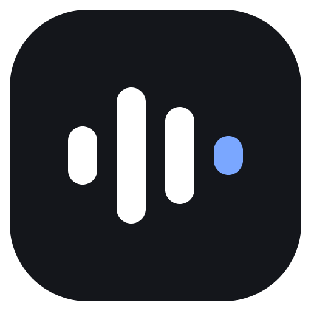

<p align="center"></p>

<h1 align="center">Toolbay Flow</h1>

<p align="center"><b>Free, local, open-source voice dictation for any app.</b><br>
Hold a key, speak, let go: clean, punctuated text appears wherever your cursor is.<br>
No account. No word limits. No subscription. Nothing leaves your computer.</p>

---

Toolbay Flow is the first free tool in the [Toolbay](https://toolbay.ai) collection: open-source rebuilds of paid
software. It does what paid voice-dictation apps do, with speech recognition
([whisper.cpp](https://github.com/ggml-org/whisper.cpp)) and text cleanup ([llama.cpp](https://github.com/ggml-org/llama.cpp)
with an open Qwen model) running on your own hardware.

It's written from scratch (Tauri 2 + Rust + React). No code, assets or services from any commercial product are used.

## Install

**Windows 10/11:** download `Toolbay.Flow_x.y.z_x64-setup.exe` from [Releases](https://github.com/sriptcollector/toolbay-flow/releases/latest)
and run it. It installs for your user only (no admin prompt). The setup screen downloads the AI models once (about 0.2 to 3 GB
depending on what you pick).

**macOS (Apple Silicon or Intel):** download the `.dmg` from Releases. The macOS build is produced by CI but has
not been tested on a real Mac yet; see *Status* below. Grant Microphone, Accessibility and Input Monitoring when asked.

**Through the Toolbay app:** open Toolbay, find *Flow*, click Install. Toolbay reads [`toolbay.json`](toolbay.json),
downloads the installer from the latest GitHub release and launches Flow in its own window.

## How to use it

| Do this | Windows | macOS |
|---|---|---|
| Dictate (hold, speak, release) | `Ctrl + Win` | `Fn` |
| Hands-free (start/stop) | `Ctrl + Win + Space`, or double-tap `Ctrl + Win` | `Fn + Space` |
| Command mode (edit selected text by voice) | `Ctrl + Win + Alt` | `Fn + Ctrl` |
| Paste last dictation | `Alt + Shift + Z` | `⌘ + Ctrl + V` |
| Copy last dictation | `Alt + Shift + X` | `⌘ + Ctrl + C` |
| Cancel while listening | `Esc` | `Esc` |
| Transforms 1 / 2 / 3 on selected text | `Win + Alt + 1/2/3` | `Option + 1/2/3` |

Every shortcut can be changed in **Shortcuts**, including modifier-only combos.

## Features

- **Global push-to-talk and hands-free hotkeys** with a low-level keyboard hook (modifier-only chords, double-tap to lock,
  Esc to cancel, Start menu suppression for Win chords).
- **Flow bar**: a small always-on-top pill at the bottom of the screen with a live waveform, hands-free stop/cancel buttons,
  processing and done states, error and "learned a word" toasts. It follows the monitor your mouse is on and is
  click-through everywhere except the pill.
- **Local speech recognition** with whisper.cpp. Built-in model downloader from Tiny to Large v3 Turbo. NVIDIA GPUs
  use CUDA automatically (a 10-second clip transcribes in about 0.1 s on an RTX 4070 Ti).
- **AI cleanup**: removes fillers and stutters, applies spoken corrections ("6, no wait, 7" → "7"), punctuation, spoken
  commands ("new line", "question mark"), lists, numbers and email layout. Runs locally through llama.cpp
  (Qwen3 4B Instruct on GPU, Qwen3 1.7B for CPU-only machines), with a rule-based fallback.
  Four levels: Off, Light (rules only), Standard, Polished.
- **Bring your own key (optional)**: any OpenAI-compatible endpoint or Anthropic, if you prefer a cloud model.
- **Styles per app category** (personal messages, work messages, email, everything else): Formal, Casual, Very casual, Excited,
  plus your own app → category rules.
- **Context awareness**: reads the focused app, window title, selected text and the text around the cursor (Windows UI Automation,
  macOS Accessibility) so dictation continues your sentence naturally. Password fields are never read.
- **Personal dictionary**: words and names to always spell right (also fed to the speech model), replacement rules,
  starring, usage counts, and **auto-learning**: fix a word after pasting and Flow adds it, with Undo.
- **Snippets**: say a cue ("my calendar link") and get the full text.
- **Command mode**: select text, hold the command key and say "make this friendlier" or "translate to Spanish";
  with nothing selected, say "reply saying I'll be there at 5" to write new text.
- **Transforms**: three editable rewrite presets (Polish, Prompt engineer, Make it shorter) on hotkeys.
- **Paste into any app** via the clipboard and a simulated Ctrl/⌘+V, then your previous clipboard (all formats) is restored.
  Dictations are kept out of Windows clipboard history.
- **History** with search, copy, "show original transcript", re-transcribe from saved audio, delete.
- **Insights**: total words, words per minute, streaks, time saved, per-app usage, activity heatmap.
- **Scratchpad** notes you can dictate into.
- **Languages**: 99 languages with multilingual models, or auto-detect.
- **Onboarding**: privacy choices, microphone test, model download sized to your hardware, shortcut test, language, try-it box.
- **Tray menu**: open, paste last dictation, microphone and language pickers, show/hide bar, quit.
- **Settings**: launch at login, sounds (synthesized, no audio files), mute other audio while dictating, keep clipboard,
  history retention (keep / 24 hours / never), keep recordings for 14 days, delete all.
- **Privacy**: no accounts, no servers, no telemetry. The network is only used to download the models and engines you pick,
  and to reach your own cloud provider if you choose one.

## Status

| Area | State |
|---|---|
| Windows 10/11 x64 | Built, installed and tested on Windows 11 with an RTX 4070 Ti |
| macOS | Configured and built in CI (Accessibility, CGEventTap hotkeys, Cmd+V paste, Metal engines). **Not yet tested on a Mac.** |
| Speech on AMD/Intel GPUs (Windows) | Runs on CPU for now (cleanup already uses Vulkan on any GPU) |
| Meeting notetaker, cloud sync, teams, mobile apps | Not included (out of scope for v0.1) |

## Build from source

Requirements: Node 20+, Rust stable, and on Windows the Visual Studio C++ Build Tools.

```bash
npm install
npm run tauri dev      # run in development
npm run tauri build    # produce the installer in src-tauri/target/release/bundle
cargo test --manifest-path src-tauri/Cargo.toml
```

Code map:

| Path | What |
|---|---|
| `src-tauri/src/hotkeys/` | Chord matcher, Windows WH_KEYBOARD_LL hook, macOS listener |
| `src-tauri/src/audio.rs` | Microphone capture (cpal), resampling to 16 kHz, levels |
| `src-tauri/src/engines.rs` | Model/engine catalog, downloader, local whisper/llama servers |
| `src-tauri/src/llm.rs` | Speech request, cleanup / command / transform prompts, BYO-key providers |
| `src-tauri/src/textproc.rs` | Rule-based cleanup, dictionary, snippets, styles, learning |
| `src-tauri/src/context.rs` | Focused app and text around the cursor (UI Automation / AX) |
| `src-tauri/src/paste.rs` | Clipboard snapshot, paste, restore |
| `src-tauri/src/dictation.rs` | The dictation state machine |
| `src/bar/` | The floating Flow bar |
| `src/hub/` | Main window: onboarding, history, insights, dictionary, snippets, style, transforms, scratchpad, models, shortcuts, settings |

## Toolbay integration

`toolbay.json` describes the app for the Toolbay launcher: id, version, the release asset per platform, how to install it
silently (`/S` for the per-user NSIS installer) and how to launch it (`--from-toolbay`). Flow is single-instance: launching
it again focuses the open window.

## Credits

- [whisper.cpp](https://github.com/ggml-org/whisper.cpp) and [llama.cpp](https://github.com/ggml-org/llama.cpp) (MIT)
- OpenAI Whisper models (MIT), Qwen3 models by Alibaba (Apache 2.0)
- [Tauri](https://tauri.app) (MIT / Apache 2.0)

## License

MIT. See [LICENSE](LICENSE).
